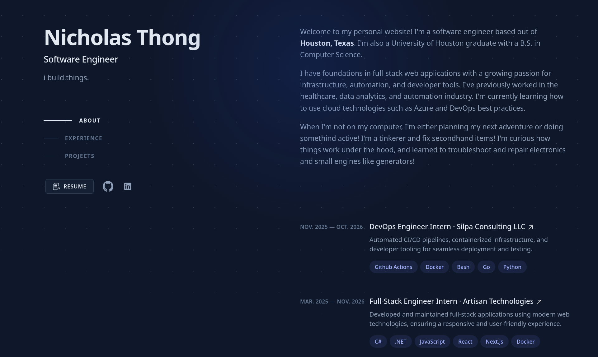

<h1 align="center">
    <a href="https://www.nkthong.com">nkthong.com</a>
</h1>



> Rewritten using **Bun**, **Astro**, and **Tailwind CSS**. \
> Heavily inspired by [brittanychiang.com](https://brittanychiang.com/) (originally built with Next.js).

## 📂 Project Structure

Inside of this project, you'll see the following folders and files:

```text
nkthong/
├── public/
│   └── ...
├── src/
│   ├── assets/
│   │   └── *.svg
│   ├── components/
│   │   └── ...
│   ├── layouts/
│   │   └── ...
│   ├── pages/
│   │   └── ...
│   └── styles/
│       └── ...
├── package.json
├── astro.config.mjs
├── README.md
└── tsconfig.json
```

## 🚀🛠️ Deploy

This project is currently being hosted on [vercel](https://www.vercel.com).

To get the project running locally:

```bash
$ bun install
$ bun dev
```

Afterwards, happy developing!

## 🧑‍💻 Commands

All commands are run from the root of the project, from a terminal:

| Command               | Action                                           |
| :-------------------- | :----------------------------------------------- |
| `bun install`         | Installs dependencies                            |
| `bun dev`             | Starts local dev server at `localhost:4321`      |
| `bun build`           | Build your production site to `./dist/`          |
| `bun preview`         | Preview your build locally, before deploying     |
| `bun astro ...`       | Run CLI commands like `astro add`, `astro check` |
| `bun astro -- --help` | Get help using the Astro CLI                     |
